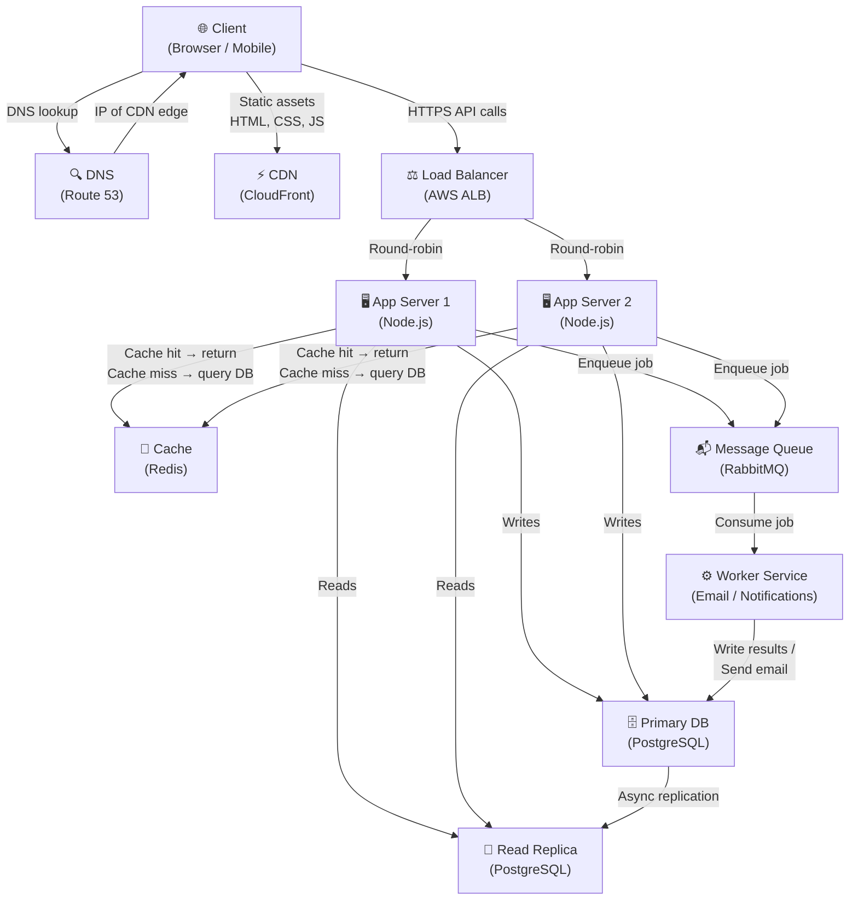

# QuickNotes – Architecture Document

---

## Table of Contents

1. [Requirements](#requirements)
2. [Load Estimates — 1 Million Users](#load-estimates--1-million-users)
3. [Architecture Diagram](#architecture-diagram)
4. [Component Explanations](#component-explanations)
5. [Request Flows](#request-flows)
6. [Trade-offs & Single Points of Failure](#trade-offs--single-points-of-failure)

---

## Requirements

### Functional Requirements

| # | Requirement |
|---|-------------|
| F1 | Users can register and log in with email and password |
| F2 | Authenticated users can create a note (title required, max 100 chars; optional body) |
| F3 | Users can list their own notes, paginated, newest first |
| F4 | Users can view a single note by ID |
| F5 | Users can delete their own notes |
| F6 | Users can attach and remove tags on notes |
| F7 | Users can filter their notes by tag |
| F8 | The system sends a welcome email asynchronously when a new user registers |

### Non-Functional Requirements

| # | Requirement | Target |
|---|-------------|--------|
| N1 | **Availability** | 99.9% uptime (< 8.7 h downtime/year) |
| N2 | **Read latency** | p99 < 200 ms for `GET /notes` |
| N3 | **Write latency** | p99 < 500 ms for `POST /notes` |
| N4 | **Scalability** | Must support 1 million registered users with room to grow |
| N5 | **Durability** | No note is lost once the API returns `201 Created` |
| N6 | **Security** | Passwords stored as bcrypt hashes; all traffic over TLS 1.2+ |
| N7 | **Consistency** | A user always reads their own writes within 1 second |

---

## Load Estimates — 1 Million Users

### Assumptions

| Variable | Value | Reasoning |
|----------|-------|-----------|
| Registered users | 1,000,000 | Given |
| Daily Active Users (DAU) | 200,000 | 20% of registered users active each day (industry norm) |
| Read actions per DAU per day | 10 | Open app, browse notes, search by tag |
| Write actions per DAU per day | 2 | Create ~1–2 notes per session |
| Average note size (title + body) | 1 KB | ~100 chars title + ~900 chars body in UTF-8 |
| Metadata overhead (indexes, timestamps) | 50% | Standard DB overhead factor |
| Peak-to-average traffic ratio | 5× | Rush hours vs. off-peak |

### Reads Per Second

```
Daily reads  = 200,000 DAU × 10 reads/day = 2,000,000 reads/day
Average RPS  = 2,000,000 / 86,400 s        ≈ 23 reads/sec
Peak RPS     = 23 × 5                       ≈ 115 reads/sec
```

### Writes Per Second

```
Daily writes = 200,000 DAU × 2 writes/day  = 400,000 writes/day
Average WPS  = 400,000 / 86,400 s           ≈ 5 writes/sec
Peak WPS     = 5 × 5                         ≈ 25 writes/sec
```

### Storage Per Year

```
New notes per day   = 200,000 DAU × 2 writes/day = 400,000 notes/day
New notes per year  = 400,000 × 365              = 146,000,000 notes/year
Raw storage/year    = 146,000,000 × 1 KB          ≈ 146 GB/year
With 50% overhead   = 146 GB × 1.5               ≈ 220 GB/year
```

> **Conclusion:** The load is well within the range handled by two mid-tier app servers, a single Redis node, and a PostgreSQL primary + one read replica. Horizontal scaling is available as a growth path.

---

## Architecture Diagram



---

## Component Explanations

| Component | Problem It Solves |
|-----------|-------------------|
| **Client (Browser / Mobile)** | Provides the user interface; runs `index.html`, `style.css`, and `api.js` locally to minimise server round-trips for rendering. |
| **DNS (Route 53)** | Translates the human-readable domain `quicknotes.io` into the CDN's IP address so browsers know where to send requests. |
| **CDN (CloudFront)** | Caches and serves static assets (HTML, CSS, JS) from edge nodes close to the user, eliminating latency from serving files all the way from the origin data-centre. |
| **Load Balancer (AWS ALB)** | Distributes incoming HTTPS API requests across multiple app servers so no single server becomes a bottleneck, and performs health checks to route away from unhealthy instances. |
| **App Server 1 & 2 (Node.js)** | Execute the business logic — authenticate the user, validate input, orchestrate reads and writes — and are stateless so any server can handle any request. |
| **Cache (Redis)** | Stores frequently read note lists in memory so repeated `GET /notes` calls are served in < 1 ms instead of hitting the database every time. |
| **Primary Database (PostgreSQL)** | The source of truth for all writes; enforces referential integrity and ACID transactions so no data is ever partially written. |
| **Read Replica (PostgreSQL)** | Receives an async copy of every write from the primary and handles all read queries, keeping read load off the primary and allowing it to focus on writes. |
| **Message Queue (RabbitMQ)** | Decouples slow or non-critical work (sending welcome emails, push notifications) from the request path so `POST /notes` returns fast without waiting for email delivery. |
| **Worker Service** | Consumes jobs from the queue and performs background tasks (SMTP email, webhook delivery) outside the HTTP request cycle, preventing these operations from blocking user-facing responses. |

---

## Request Flows

### `GET /notes` — Load a user's 10 most recent notes

```
1.  Browser calls:  GET https://api.quicknotes.io/v1/notes?limit=10
2.  DNS resolves api.quicknotes.io → Load Balancer IP.
3.  Load Balancer receives the request and picks App Server 2 (round-robin).
4.  App Server 2 validates the Bearer token (JWT signature + expiry check).
        → If invalid: return 401 Unauthorized immediately.
5.  App Server 2 constructs a cache key: "notes:user:{userId}:page:1".
6.  App Server 2 queries Redis (Cache):
        → CACHE HIT:  return the cached JSON list → go to step 10.
        → CACHE MISS: continue to step 7.
7.  App Server 2 queries the Read Replica:
        SELECT id, title, body, created_at
        FROM notes WHERE user_id = ? ORDER BY created_at DESC LIMIT 10;
8.  Read Replica returns the result rows.
9.  App Server 2 serialises the rows to JSON and writes them into Redis
        with a TTL of 60 seconds.
10. App Server 2 returns HTTP 200 OK with the notes array to the client.

Total happy-path latency target: < 200 ms (p99).
```

---

### `POST /notes` — Create a new note

```
1.  Browser calls:  POST https://api.quicknotes.io/v1/notes
                    Body: { "title": "...", "body": "..." }
2.  DNS resolves → Load Balancer IP.
3.  Load Balancer picks App Server 1.
4.  App Server 1 validates the Bearer token.
        → If invalid: return 401 Unauthorized.
5.  App Server 1 validates the request body:
        → title missing or empty:   return 400 Validation Error.
        → title length > 100 chars: return 400 Validation Error.
6.  App Server 1 opens a transaction on the Primary DB and inserts the note:
        INSERT INTO notes (user_id, title, body, created_at, updated_at)
        VALUES (?, ?, ?, NOW(), NOW()) RETURNING id;
7.  Primary DB commits the transaction and returns the new note id.
8.  App Server 1 publishes a "note.created" event to the Message Queue
        (fire-and-forget — does NOT block the HTTP response).
9.  App Server 1 invalidates the Redis cache key for this user's note list:
        DEL "notes:user:{userId}:page:1"
        (ensures the next GET reflects the new note, not stale cache)
10. App Server 1 returns HTTP 201 Created with the full note object.
11. Worker consumes the "note.created" event from the Queue asynchronously
        and performs any background tasks (analytics logging, etc.).

Total happy-path latency target: < 500 ms (p99).
```

---

## Trade-offs & Single Points of Failure

### Trade-off 1 — Cache Consistency vs. Read Performance

**Decision:** Read note lists from Redis (60-second TTL) rather than querying the database on every request.

**Benefit:** Reduces database load dramatically. At 115 peak reads/sec, serving cache hits saves ~100 RPS from ever reaching PostgreSQL, keeping query latency low for writes.

**Cost:** A user who creates a note on one device might not see it immediately on another device (up to 60 s stale window). This is acceptable for a note-taking app where eventual consistency within 1 minute is fine, but would be unacceptable in a financial ledger.

**Mitigation:** On `POST /notes`, App Server immediately deletes (`DEL`) the affected cache key (cache invalidation). The creating user sees their own note instantly; other sessions see it within the TTL window.

---

### Trade-off 2 — Asynchronous Email via Queue vs. Synchronous Delivery

**Decision:** Welcome emails are enqueued in RabbitMQ and sent by a Worker rather than inline in the `POST /users` request handler.

**Benefit:** The HTTP response returns to the user in < 200 ms regardless of SMTP server latency (which can be 1–5 s). If the email provider is temporarily down, the job stays in the queue and is retried — no user-facing error.

**Cost:** The user may receive their welcome email up to several seconds after registration. This is imperceptible in practice.

**Mitigation:** RabbitMQ persists messages to disk (`durable: true`) so jobs survive a broker restart. Workers implement dead-letter queues for jobs that fail repeatedly.

---

### Trade-off 3 — Read Replica Lag vs. Read Scalability

**Decision:** All `SELECT` queries run against the Read Replica, not the Primary.

**Benefit:** The Primary DB is protected from read traffic, giving it full I/O capacity for writes. Read replicas can be added independently as read volume grows.

**Cost:** PostgreSQL async streaming replication typically has 10–100 ms lag. A user who just wrote a note and immediately reads may temporarily get stale data (replication lag).

**Mitigation:** After a successful write, the App Server invalidates the Redis cache. The next `GET /notes` is a cache miss → hits the Read Replica, which will have caught up within the 60 s TTL. For use cases that truly require read-your-write consistency (e.g. the immediate redirect after save), the App Server can route that single query to the Primary.

---

### Avoiding Single Points of Failure (SPOF)

| Component | SPOF Risk | Mitigation |
|-----------|-----------|------------|
| **Load Balancer** | Single ALB failure takes down all API traffic | AWS ALB is a managed, multi-AZ service; if one AZ fails, traffic is automatically routed to healthy AZs |
| **App Servers** | One server crash drops in-flight requests | Two+ stateless servers behind the LB; health checks remove a failed instance within 30 s; Auto Scaling Group replaces it |
| **Redis Cache** | Cache failure causes all reads to fall through to the DB | Redis failure is treated as a full cache miss — app degrades gracefully to direct DB reads; Redis Sentinel or Redis Cluster provides automatic failover |
| **Primary Database** | Primary crash causes all writes to fail | Read Replica can be promoted to Primary in < 5 min (RDS Multi-AZ does this automatically); daily snapshots provide point-in-time recovery |
| **Message Queue** | Broker crash loses queued jobs | RabbitMQ messages are durable (persisted to disk); a replica broker in a second AZ can take over |
| **Worker Service** | Worker crash leaves jobs unconsumed | RabbitMQ re-queues un-acknowledged jobs automatically; multiple worker instances can run in parallel |

---

*Document version: 1.0 · Last updated: 2026-10-16*
